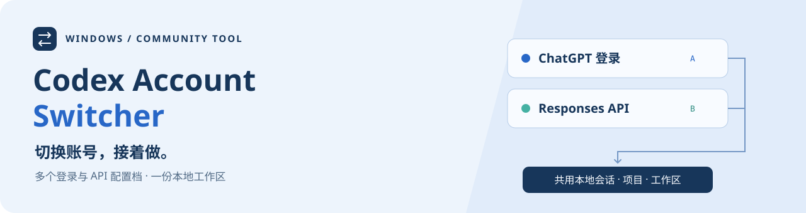
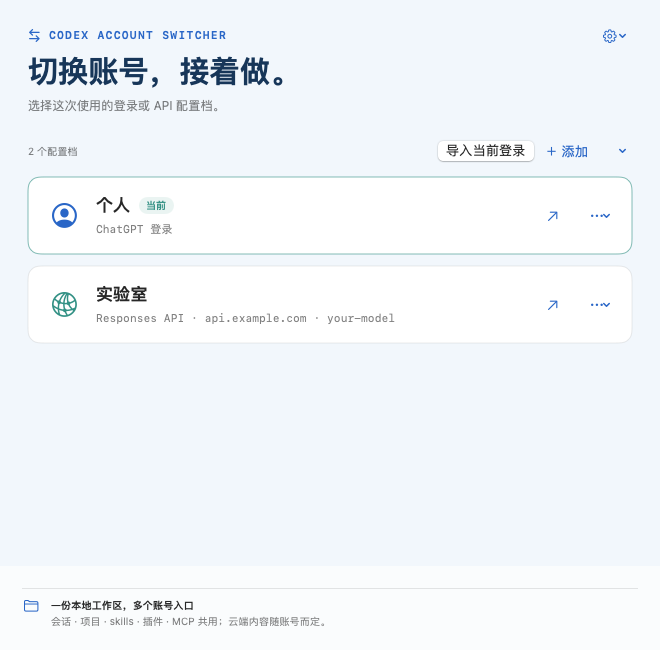
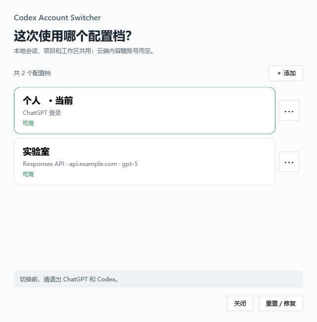

  

  
  
  
  
  

  <strong>在 Codex 桌面端切换 ChatGPT 账号和 API 服务。</strong> 
  保存多个账号，切换后继续使用原来的本地会话和项目。

  <a href="https://github.com/sheyinjue-a11y/codex-account-switcher/releases/latest"><strong>↓ 下载 Windows / macOS</strong></a>
  &nbsp; · &nbsp; <a href="#快速开始">快速开始</a>
  &nbsp; · &nbsp; <a href="#界面预览">界面预览</a>
  &nbsp; · &nbsp; <a href="https://github.com/sheyinjue-a11y/codex-account-switcher/releases">更新记录</a>

> 这是用于官方 Codex 桌面端的社区工具，支持 Windows 和 macOS，界面为中文。它不切换 ChatGPT 网页账号，也不提供账号、API Key 或额度。

## 能做什么

- 保存多个 ChatGPT 账号，通过浏览器登录后，在窗口里选择要用的账号。
- 保存多个 API 服务，分别设置地址、Key 和默认模型。
- 添加、重命名、编辑和删除账号配置。
- 切换账号后保留本地会话、项目、技能和插件，继续原来的工作。
- 在本机加密保存登录信息；切换失败时恢复原配置。

支持迁移旧版保存的个人账号和实验室 API 设置。

## 界面预览

### macOS

  

### Windows

  

两张截图均为实际应用界面，使用演示数据。

## 快速开始

先安装官方 Codex。首次使用或升级前，备份本地会话目录和已有账号库，具体位置见[数据与限制](#数据与限制)。备份可能含有登录信息，请勿上传。

### Windows

1. 在[下载页面](https://github.com/sheyinjue-a11y/codex-account-switcher/releases/latest)选择 `Codex-Account-Switcher-Windows.zip`，完整解压到准备长期保留的目录。不要选 GitHub 自动生成的 Source code ZIP。
2. 双击 **Codex Account Switcher.exe**。首次使用按窗口提示登录 ChatGPT 或导入已有登录；已有账号库会直接打开。
3. 点「＋ 添加」保存其他 ChatGPT 账号或 API 配置，点击账号卡片即可切换并启动 Codex。

导入及切换前，请退出 Codex 桌面端、终端中的 Codex 和编辑器里的 Codex。保留 `.exe` 旁边的 `app` 文件夹；需要桌面入口时，为 `.exe` 创建快捷方式。

普通账号切换无需管理员权限，也不用另装 Node.js 或 Python。程序未签名，Windows 可能提示未知发布者，请确认下载来源后再运行。若脚本被拦截，可在 ZIP 属性中解除阻止后重新解压；不要全局降低 PowerShell 执行策略。受公司策略限制时，请联系管理员。

### macOS

1. 下载 `Codex-Account-Switcher-macOS-universal.dmg`，打开后将应用拖进 **Applications**。
2. 打开切换器，选择「导入当前登录并开始」或「登录 ChatGPT 并开始」；API 用户点「使用 API」。
3. 点击账号，切换器会正常退出并重新打开 Codex。终端和编辑器中的 Codex 需要自行退出。

切换器支持 macOS 13+ 和 Intel / Apple 芯片；官方 Codex 的系统要求以官方说明为准。**当前未经过 Apple 公证**，首次打开可能被拦截，请确认来源后按系统提示处理，不要关闭 Gatekeeper。详见 [Mac 安装与恢复说明](macos/README.md)。

## API 怎么填

| 项目 | 填写方式 |
| --- | --- |
| 地址（Base URL） | 服务商提供的 Responses API 基础地址，例如 `https://api.example.com/v1`，不要加上末尾的 `/responses`。除本机测试地址外，必须使用 HTTPS。 |
| API Key | 服务商提供的密钥。编辑已有配置时，留空会保留原 Key。 |
| 模型 | 填写服务商实际支持的模型名称。 |

服务必须支持 **Responses API**，只支持 Chat Completions 的接口不能直接使用。保存配置只检查填写格式；Windows 的「测试连接」会发送请求，可能消耗额度。macOS 暂无此按钮，且只能编辑当前未使用的 API 配置。

### 模型列表怎么更新

切换器会读取本机 Codex 缓存的模型列表，并在打开切换器或切换到 API 账号时更新菜单所用的列表。它会保留你选中的模型和自定义模型列表。

更新 Codex 后，先让官方客户端刷新模型列表，再打开切换器、重启 Codex。如果一直用 API 登录而列表没有更新，可先用 ChatGPT 账号登录 Codex 刷新，再切回 API。缓存无法读取时，切换器会保留上次有效的列表。

菜单里有某个模型，不代表你的 API 服务商支持它。具体同步方式见[模型列表更新说明](docs/superpowers/plans/2026-10-01-model-catalog-refresh.md)。

### 可选：Windows API Fast

可安装本地补丁，恢复 API 登录时的 Fast 按钮和请求设置。它默认不安装，另需 Node.js；补丁修改客户端副本，官方安装包保持原样，副本不再具有有效的官方签名。安装后需从切换器启动 API 账号，开始菜单仍打开原版。模型本身需要支持 Fast，实际是否加速、如何计费由 API 服务商决定。

官方更新可能改变 Fast 的判断逻辑，**每个新版本都要验证兼容性**。开启自动重建后，代码结构仍兼容的版本会自动生成新副本；遇到不兼容的改动，需要让 agent 针对该版本修改补丁，同时检查按钮和请求设置。工具不会自行调用 agent，适配失败会提示并回到官方版。

安装方法、失效原因和可直接交给 agent 的修复说明，见 [API Fast 文档](tools/codex-api-fast/README.md)。

### Astra 首条消息预热（可选）

这是尝试缓解 Astra 首次连接问题的实验功能，默认关闭，**不保证对所有服务商有效，并可能产生额外费用**。

启用后，在新会话中向 `gpt-6-astra` 发送第一条消息前，工具会先向同一服务商的 `gpt-5.6-sol` 发送一句固定的 `Reply only OK.`（推理强度为 `low`）。成功后再发送原来的 Astra 消息；原文、附件和工作区内容不会发给 Sol。同一账号的同一会话预热成功后不会重复；失败时原消息会被拦截，可以重试或关闭预热。

先切到要使用的 API 账号，在设置中开启 Astra 预热，确认费用，再按 Codex 提示审查并信任预热脚本（hook），重启 Codex。服务商须支持上述两个模型。更换地址或 Key 后需重新启用；ChatGPT 登录和其他模型不会触发预热。登录信息须保存在默认 `.codex` 目录；手动配置的服务商（provider）、配置分组（profile）和环境变量指定的接口暂不支持。

关闭时，切回对应 API 账号，在同一设置中关闭并重启 Codex。**移动、替换或卸载程序前，先关闭各账号的预热功能**，避免 Codex 继续调用旧路径。若更新后预热报错，也请先关闭；若提示安装路径不支持，请移到不含特殊字符的普通本地目录。

## 数据与限制

| 内容 | Windows | macOS |
| --- | --- | --- |
| 本地会话、项目与当前登录 | `%USERPROFILE%\.codex` | `~/.codex` |
| 切换器保存的账号与恢复记录 | `%LOCALAPPDATA%\CodexAccountSwitcher` | `~/Library/Application Support/CodexAccountSwitcher` |
| 程序 | 解压目录 | Applications 中的应用 |

所有账号共用本地会话、项目、技能、插件和工作区，云端内容仍属于各自账号。**切换到另一 API 后继续旧会话，可能会把历史消息发给新的服务商。** 请确认对方可以接收这些内容。

切换时，同一目录不能被其他 Codex 进程占用，也不支持同时运行不同账号。当前只管理默认 `.codex` 目录，不支持自定义 `CODEX_HOME`；首次导入也不支持自定义服务商配置（provider）。使用自定义服务商的用户，可先在默认目录中通过官方账号登录，再在切换器里添加 API。Mac 对其他复杂配置的限制见 [Mac 说明](macos/README.md)。

当前使用的配置和最后一个有效配置不能删除。「重置 / 修复」用于检查和恢复配置，不会清空账号和历史。

账号库使用本机加密，不能直接搬到另一台电脑或另一种系统使用。Codex 使用中的登录文件仍可被当前用户权限下的程序读取；加密账号库不能防止这类程序窃取信息。详见[安全说明](SECURITY.md)。

## 常见问题

- **提示 Codex 仍在运行**：退出桌面端、终端和编辑器中的 Codex 后重试。工具不会强制结束任务。
- **第一次打开没有账号**：按向导完成浏览器登录后会自动导入；只用 API 的用户也可导入官方 CLI 已保存的 API 登录。
- **提示账号身份不一致**：若当前登录是已保存的账号，工具可校正状态；不认识的账号不会覆盖旧配置。先备份再排查，不要直接删除登录文件或恢复记录。
- **切换成功但 Codex 没打开**：确认官方桌面端安装正常，再点一次同一账号。
- **移动了程序目录**：Windows 的 `.exe` 与 `app` 文件夹要一起移动，并更新桌面快捷方式；已开启 Astra 预热的账号须先关闭预热。
- **如何卸载**：先关闭各账号的 Astra 预热，再删除程序和快捷方式。账号库与 `.codex` 会保留；如需删除登录信息，先确认备份和当前使用的账号。

## 验证与开发

自动测试使用临时目录、模拟登录信息和本机模拟服务，检查账号切换、共享会话、模型列表和 Astra 预热，不调用真实付费模型。运行方法见[开发说明](CONTRIBUTING.md)，API Fast 的测试见其[专门文档](tools/codex-api-fast/README.md#验证)。

项目仍为公开预览版。自动测试不能覆盖每台电脑的浏览器登录、桌面启动和 API 服务；具体版本的测试结果见 [Actions](https://github.com/sheyinjue-a11y/codex-account-switcher/actions) 和[发布说明](https://github.com/sheyinjue-a11y/codex-account-switcher/releases)。

## 许可证

[MIT](LICENSE)。这是独立社区项目，与 OpenAI 无隶属关系。OpenAI、Codex、ChatGPT 名称归相应权利人所有。
